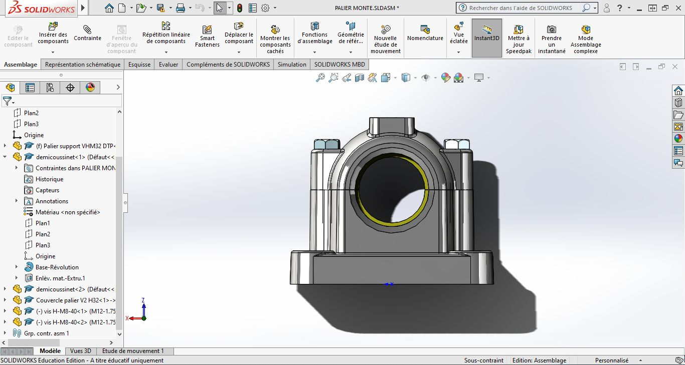
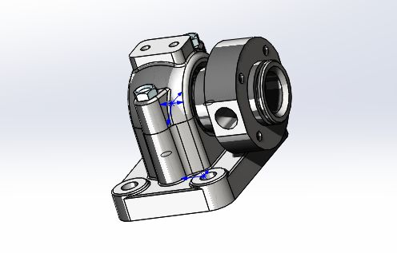
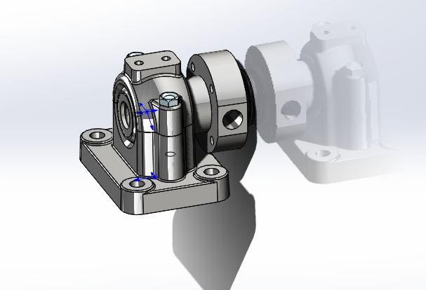
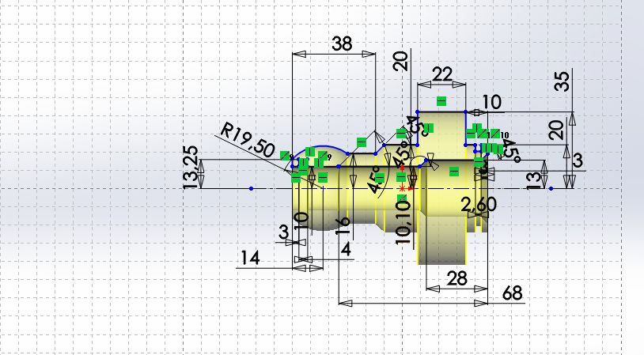
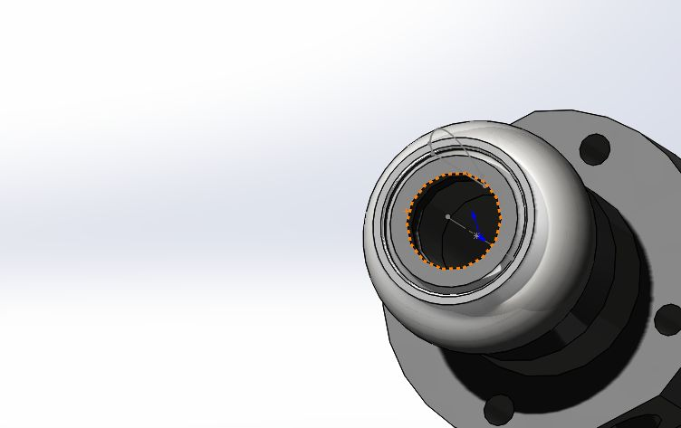
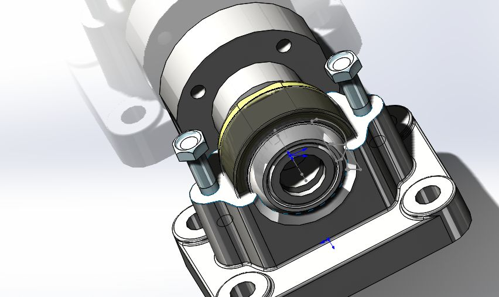
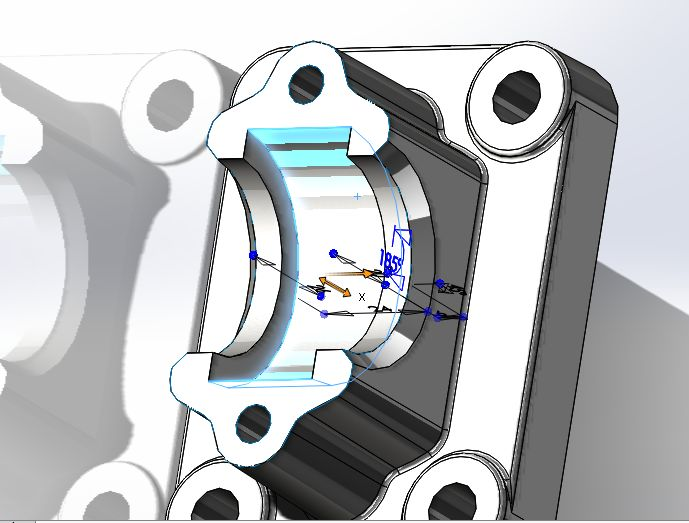

# Modification d'un vérin sous SolidWorks : remplacer des demi-coussinets par une rotule

🇫🇷 [Français](#français) · 🇬🇧 [English](#english)

---

## Français

### Contexte
Travaux pratiques de sciences de l'ingénieur en **CPGE TSI** (septembre 2024), sur le **pilote hydraulique** d'un voilier : le système qui oriente le safran à partir d'un cap de consigne, grâce à une pompe hydraulique et à un vérin.
TP réalisé **en groupe de cinq**, chacun traitant une partie du sujet. **Ma partie (C) porte sur le vérin** : l'analyse de la liaison entre le fond du vérin et son palier support, puis sa modification dans SolidWorks.

Les pièces de départ (palier, couvercle, fond de vérin, rotule) sont des **modèles fournis avec le sujet**. Ce dépôt ne contient que **mes captures d'écran** du travail réalisé dessus, pas les fichiers du sujet.

### 1. Analyse de la solution existante
À l'origine, le fond du vérin tourne dans son palier grâce à **deux demi-coussinets**, serrés par un couvercle et deux vis.

| Question | Ce que j'en ai retenu |
|---|---|
| Pourquoi deux demi-coussinets ? | Ils répartissent la charge, réduisent le frottement, rattrapent l'usure et se changent sans démonter tout le vérin. |
| Mise en position du couvercle sur le palier | Par épaulements et centrage, puis maintien par les vis de fixation. |
| Matériaux et bruts | Aciers pour les pièces chargées, bronze ou plastique technique pour les surfaces de frottement ; bruts de fonderie ou de forge, puis usinage. |
| Usinage de l'alésage sur couvercle et palier assemblés | Garantit l'alignement parfait des deux demi-alésages, mais les deux pièces deviennent **appairées** (non interchangeables) et le coût de fabrication augmente. |
| Fixation du corps de pompe sur le couvercle | Par vis : solution simple mais sensible au **desserrage sous vibrations**. |
| Absence de joint d'étanchéité | Risque de fuites de fluide, de perte de pression et d'usure prématurée des pièces, donc un pilote moins précis et moins fiable. |

### 2. Modification : une rotule à la place des demi-coussinets
Le cahier des charges impose une **rotule radiale sans entretien GE 30 FW-2RS** (effort maximal du vérin 2 400 N, inclinaison du vérin jusqu'à ±15°, durée de vie visée 130 000 h). Étapes réalisées dans SolidWorks :

1. **Supprimer** les deux demi-coussinets, le couvercle, les vis de fixation et toutes les contraintes d'assemblage qui leur étaient attachées.
2. **Insérer** la rotule et le nouveau fond de vérin, puis les **assembler** au palier par des contraintes (coaxialités, coïncidences), sans encore se soucier de la forme des surfaces de liaison.
3. **Modifier l'esquisse de révolution du fond de vérin** pour mettre et maintenir en position la **bague intérieure** de la rotule : nouvelle portée, épaulement et cotes reprises (par exemple, une cote passe de 24 à 38 mm et le rayon de 21,5 à 19,5 mm).
4. **Modifier l'esquisse de l'alésage du palier support** pour mettre et maintenir en position la **bague extérieure** de la rotule.

| | |
|---|---|
|  |  |
| Assemblage de la rotule et du fond sur le palier | Autre vue de l'assemblage |
|  |  |
| Esquisse du fond de vérin modifiée (cotes et relations) | Bague intérieure de la rotule en position sur le fond |
|  |  |
| Assemblage final : rotule dans le palier, couvercle et vis | Alésage du palier support repris pour la bague extérieure |

### Compétences mobilisées
- lire et critiquer une solution technologique existante avant de la modifier ;
- travailler dans un **assemblage existant** : supprimer proprement des pièces et leurs contraintes sans casser le reste ;
- modifier une pièce **par son esquisse** (cotes et relations géométriques) pour l'adapter à un composant normalisé ;
- penser aux arrêts axiaux : chaque bague de la rotule doit être mise **et** maintenue en position.

### Limites
Les fichiers SolidWorks modifiés n'ont pas été conservés : seules les captures prises pendant le TP restent. Le choix de la rotule n'a pas été vérifié par un calcul de durée de vie dans ce TP.

---

## English

### Context
Engineering science lab in **CPGE TSI** (preparatory classes, September 2024) on a sailing boat's **hydraulic autopilot**, the system that steers the rudder from a set heading using a hydraulic pump and a cylinder. Done **in a group of five**, each student handling one part. **My part (C) was the cylinder**: analysing the joint between the cylinder end and its support bearing, then modifying it in SolidWorks.

The starting parts are **models supplied with the lab subject**. This repository only contains **my screenshots** of the work done on them, not the subject files.

### 1. Analysis of the existing design
Originally the cylinder end rotates in its bearing on **two half-bushings**, clamped by a cap and two bolts. I analysed why two half-bushings are used, how the cap is located on the bearing, materials and blanks, the benefit of boring cap and bearing together (perfect alignment, but matched, non-interchangeable parts and higher cost), the bolted pump body (loosening under vibration) and the missing seal (fluid leaks, pressure loss, premature wear).

### 2. Modification: a spherical plain bearing instead of the half-bushings
The specification requires a **maintenance-free radial spherical plain bearing GE 30 FW-2RS** (max cylinder force 2,400 N, tilt up to ±15°, target life 130,000 h). Steps carried out in SolidWorks:
1. **delete** the half-bushings, cap, bolts and all their mates;
2. **insert** the spherical bearing and the new cylinder end and **mate** them to the bearing housing;
3. **edit the revolve sketch of the cylinder end** to locate and retain the **inner ring** (new seat and shoulder, dimensions changed, e.g. one dimension from 24 to 38 mm and the radius from 21.5 to 19.5 mm);
4. **edit the bore sketch of the support housing** to locate and retain the **outer ring**.

See the screenshots above.

### Limitations
The modified SolidWorks files were not kept: only the screenshots taken during the lab remain. The bearing choice was not checked with a life calculation in this lab.
